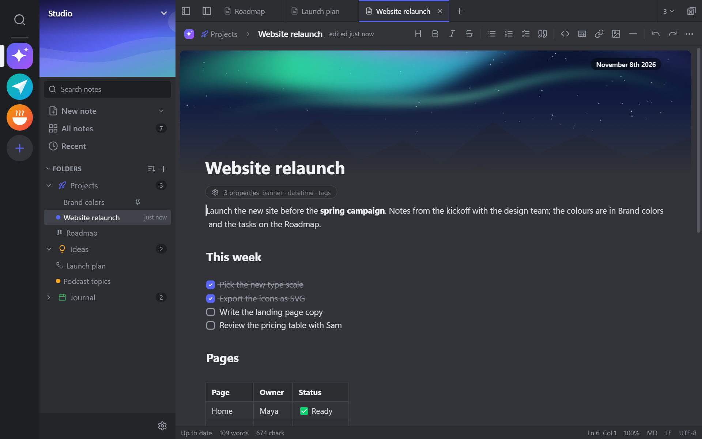
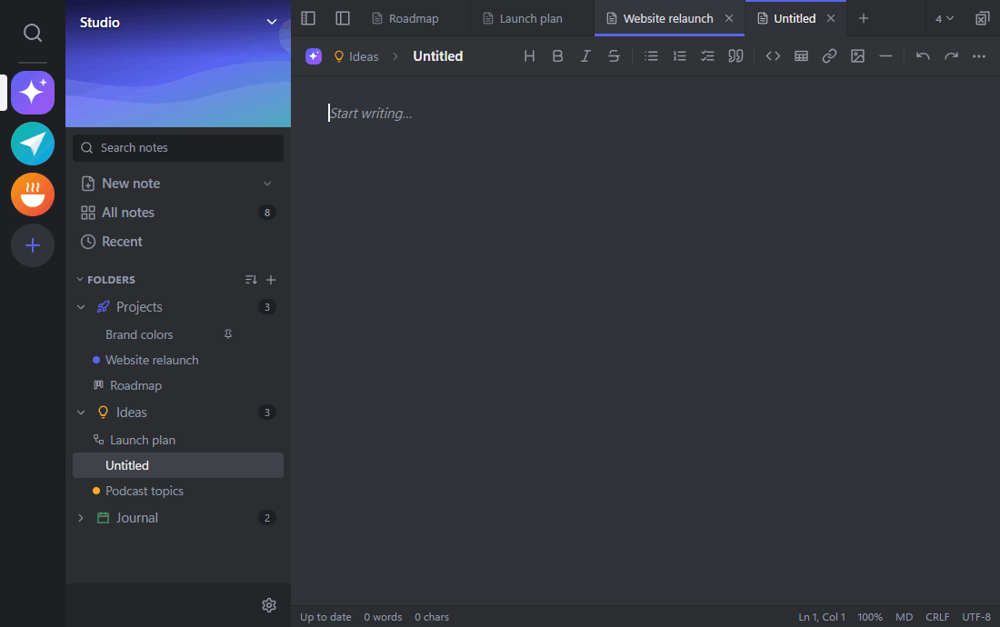
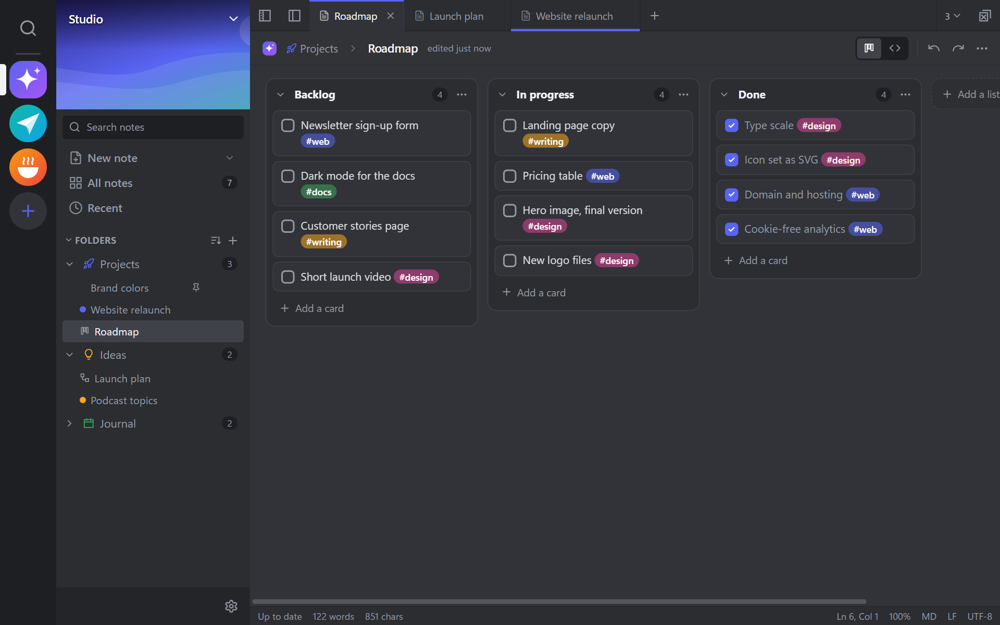
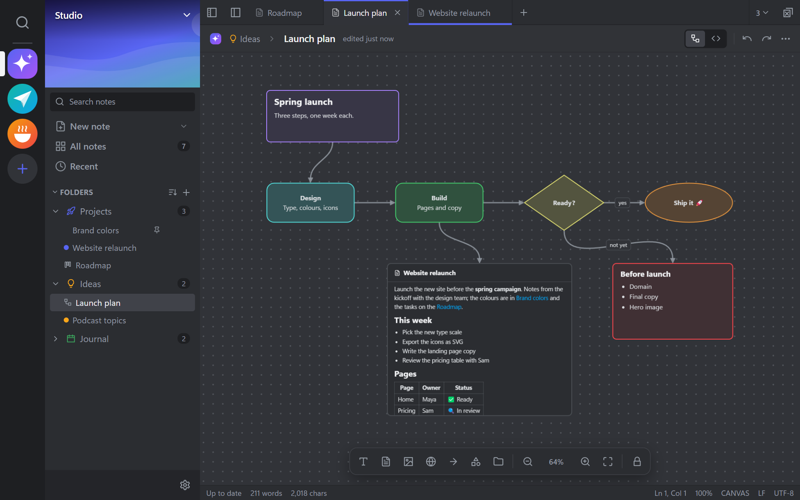
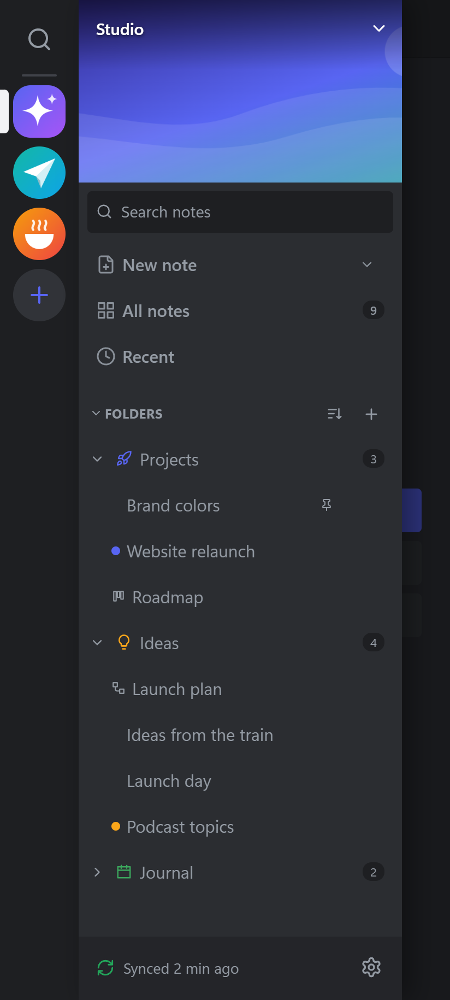
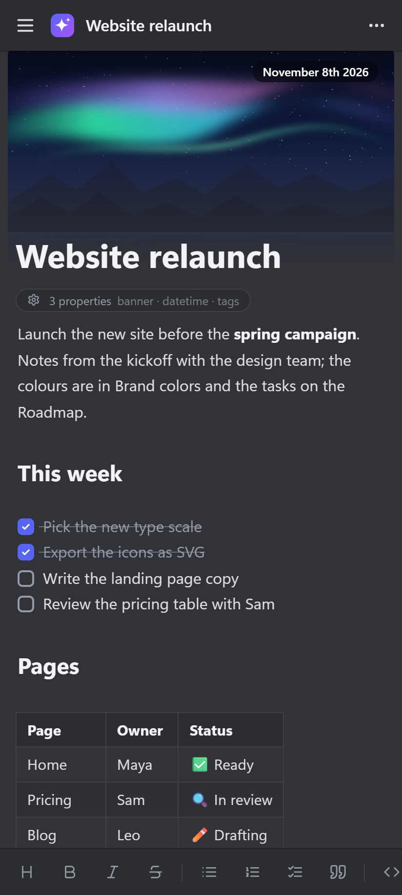
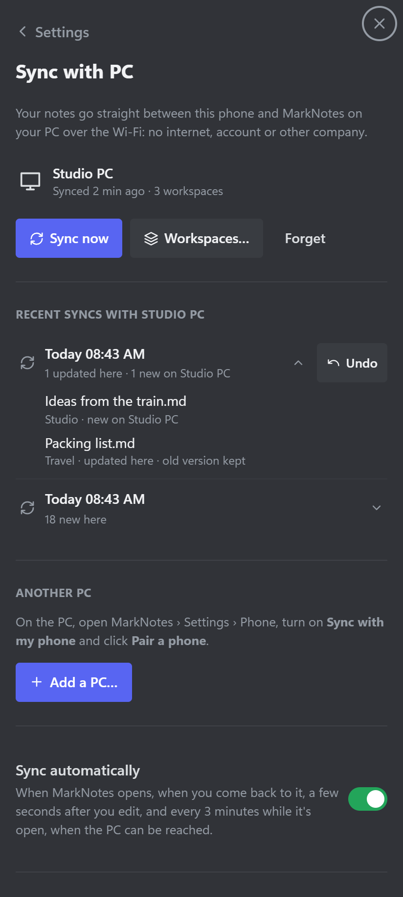

# MarkNotes

Offline notes for Windows and Android: Markdown notes, kanban boards and canvases in workspaces, a live-preview editor,
offline transcription on the PC, and a sync that goes straight from your PC to your phone over your own Wi‑Fi. No
account, no cloud, no other company in between.



## Download

The Windows installer and the Android APK are on the [latest release](https://github.com/shinnahu/MarkNotes/releases/latest).

* **Windows 10 (1809 or later) or 11, 64-bit:** `MarkNotes-Setup-<version>.exe` installs for your user, without admin
  rights. MarkNotes needs the .NET 8 Desktop Runtime and the WebView2 Runtime (Windows 11 already has it); if one is
  missing, the installer offers its download page. The installer isn't code-signed, so Windows may say "Windows
  protected your PC": click **More info**, then **Run anyway**.
* **Android 8 or later:** open `MarkNotes-Android-<version>.apk` on the phone and allow installing from that source.
  Play Protect may warn about an unknown developer: **Install anyway**.
* The release builds leave out the Spine model player (see [Third-party code](#third-party-code)): `.skel` files are
  plain files there.

## Live preview

Markdown turns into headings, bold text and checklists as you type.



## Kanban boards and canvases

Boards are written in the Obsidian Kanban plugin's format and canvases are JSON Canvas files, the format Obsidian uses.

<p>
  
  
</p>

## On your phone

MarkNotes for Android has the same workspaces and notes, and syncs with the PC over your Wi‑Fi. Every sync is listed
with what it changed, and can be undone.

<p>
  
  
  
</p>

## What's in this repository

| Folder | What it is |
|---|---|
| [`src/`](src) | MarkNotes for Windows: a .NET 8 WinForms + WebView2 host and the interface (Preact + CodeMirror 6). See [src/README.md](src/README.md). |
| [`android/`](android) | MarkNotes for Android: the same interface in a WebView, with a Java port of the note store and the sync client. See [android/README.md](android/README.md). |

## Build

**Windows** (Node.js 18+, .NET 8 SDK):

```powershell
cd src
powershell -ExecutionPolicy Bypass -File build.ps1              # app → src\publish
powershell -ExecutionPolicy Bypass -File build.ps1 -Installer   # + installer\MarkNotes-Setup-<version>.exe
```

`-Installer` downloads Inno Setup from NuGet the first time.

**Android** (Node.js 18+, JDK 17+, Android SDK 35):

1. Put `sdk.dir=<path to the Android SDK>` in `android/local.properties`.
2. Make your own signing key and an `android/keystore.properties` with `storeFile`, `storePassword`, `keyAlias` and
   `keyPassword`. Neither is in this repository.
3. The first build needs internet for Gradle's downloads: run `npm install` and `node build.mjs` in `src/web`, then
   `.\gradlew.bat :app:assembleRelease` in `android/`. After that, `android\build.ps1` builds the web UI and
   `MarkNotes-Android-<version>.apk` offline.

Add `-Public` to either build script for a build you share with others: it leaves out the Spine model player (see
[Third-party code](#third-party-code)) and writes the installer or the APK to `release\`.

## Phone sync and privacy

* Off until you turn on **Settings › Phone › Sync with my phone** on the PC.
* Only devices on your local network are answered; nothing goes through the internet or a server.
* A phone is paired only while **Pair a phone…** is open on the PC, both show the same 6-digit code, and you click
  **Allow**.
* Each PC makes its own key (stored encrypted for that Windows user) and each paired phone gets its own 256-bit secret,
  so a copy of MarkNotes somewhere else has no way into yours.
* Every connection is encrypted (ECDH P-256 + AES-256-GCM). Details: [android/PROTOCOL.md](android/PROTOCOL.md).

Apart from the sync, MarkNotes only goes online for the optional speech-model download, link previews and web videos
(see [src/README.md](src/README.md#network)).

## License

MarkNotes' own code is under the [MIT License](LICENSE). Third-party code keeps its own license.

## Third-party code

The Spine model player uses the Spine Runtimes, which are under the Spine Runtimes License Agreement: they may be
passed on only by a Spine Editor licensee, or to people who each have their own Spine Editor license. So the release
builds, and any build made with `-Public`, leave the player out; a normal build includes it, for your own use (see
[src/README.md](src/README.md#spine-models)). Other dependencies are installed by npm, NuGet and Gradle under their own
licenses.
